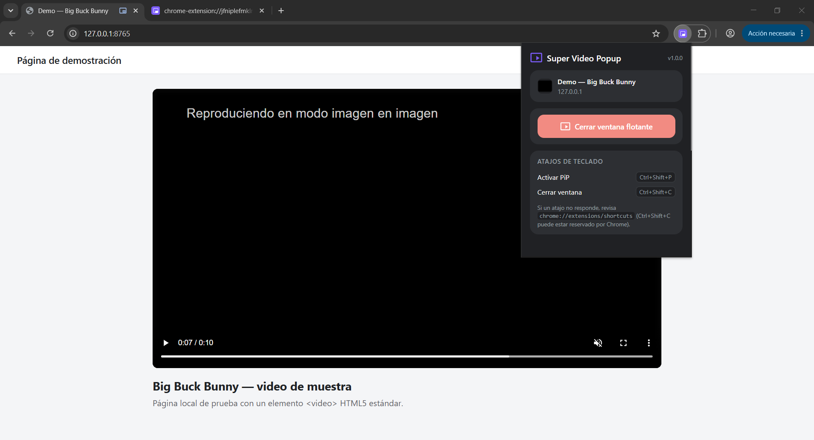
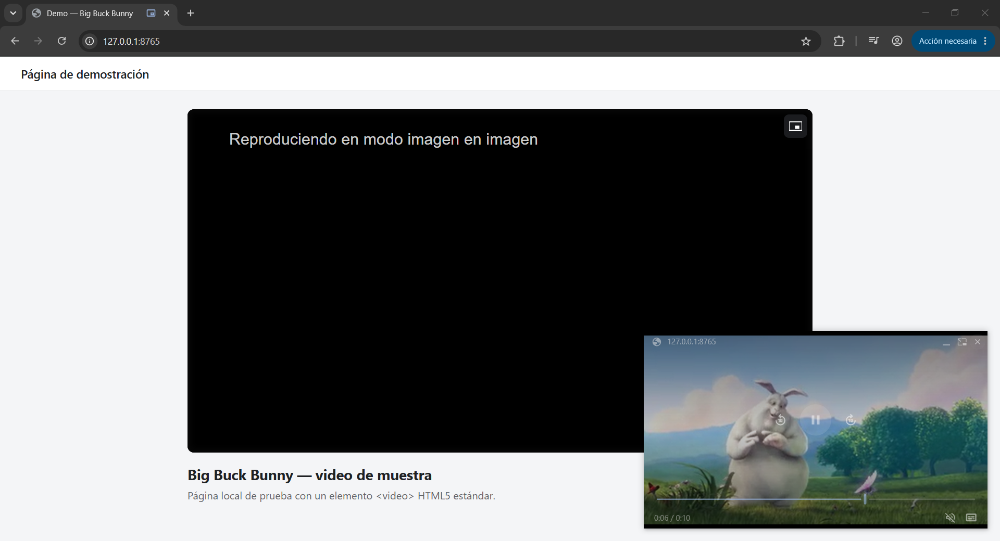
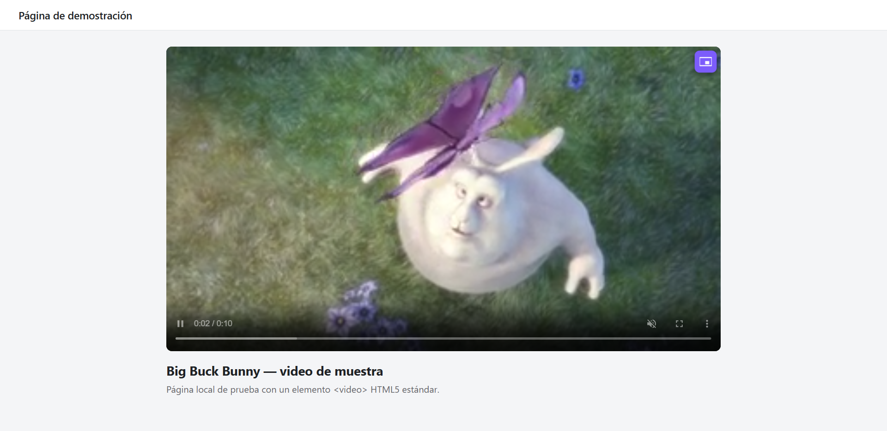

<p align="center">
  
</p>

<h1 align="center">Super Video Popup — Sitio web</h1>

<p align="center">
  Sitio web oficial de <b>Super Video Popup</b>, la extensión de Chrome que abre cualquier video en una ventana flotante que se queda encima de todo.
</p>

<p align="center">
  <a href="https://alvarosiles.github.io/webstore-super-video-popup/"><b>Ver el sitio</b></a> ·
  <a href="https://alvarosiles.github.io/webstore-super-video-popup/privacy.html">Política de privacidad</a> ·
  <a href="https://github.com/alvarosiles/super-video-popup">Código de la extensión</a>
</p>

---

## Sobre la extensión

Super Video Popup es una extensión para Google Chrome y Microsoft Edge
(Manifest V3, versión 116 o superior) que lleva el video HTML5 de la página a
la ventana flotante Picture-in-Picture del navegador. La ventana permanece
visible aunque cambies de pestaña o de aplicación.

- **Tres formas de activarla**: el icono de la extensión, un botón sobre el
  video o el atajo <kbd>Ctrl</kbd>+<kbd>Shift</kbd>+<kbd>P</kbd>
- **Cierre rápido** con <kbd>Ctrl</kbd>+<kbd>Shift</kbd>+<kbd>C</kbd> o desde el popup
- **Detección automática** del video principal de la pestaña
- **Privacidad total**: no recolecta datos ni hace peticiones de red

<p align="center">
  
  
  
</p>

## Contenido del repositorio

```
├── index.html                 # Página principal
├── privacy.html               # Política de privacidad
├── assets/
│   ├── icon32.png · icon48.png · icon128.png
│   └── capturas/              # Capturas de la extensión en funcionamiento
├── descargas/
│   └── super-video-popup-v1.0.0.zip   # Paquete de la extensión
├── LICENSE
└── README.md
```

Es un sitio estático: no tiene proceso de build, dependencias, cookies ni
herramientas de analítica.

## Instalar la extensión

1. Descarga `super-video-popup-v1.0.0.zip` desde el sitio y descomprímelo.
2. Abre `chrome://extensions` y activa el **Modo de desarrollador**.
3. Pulsa **Cargar descomprimida** y selecciona la carpeta extraída.

## Derechos

© 2026 Alvaro Siles Estrada. **Todos los derechos reservados.**

El contenido de este sitio (código, diseño, textos e imágenes) no puede
copiarse ni reutilizarse sin autorización. El paquete de la extensión de
`descargas/` se distribuye bajo licencia MIT. Ver [LICENSE](LICENSE).

Las capturas muestran el cortometraje *Big Buck Bunny* (© 2008 Blender
Foundation, [peach.blender.org](https://peach.blender.org/)), bajo licencia
[CC BY 3.0](https://creativecommons.org/licenses/by/3.0/).

## Contacto

alvarosiles.developer@gmail.com · [github.com/alvarosiles](https://github.com/alvarosiles)
